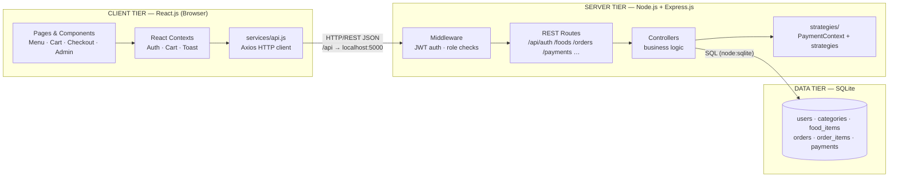
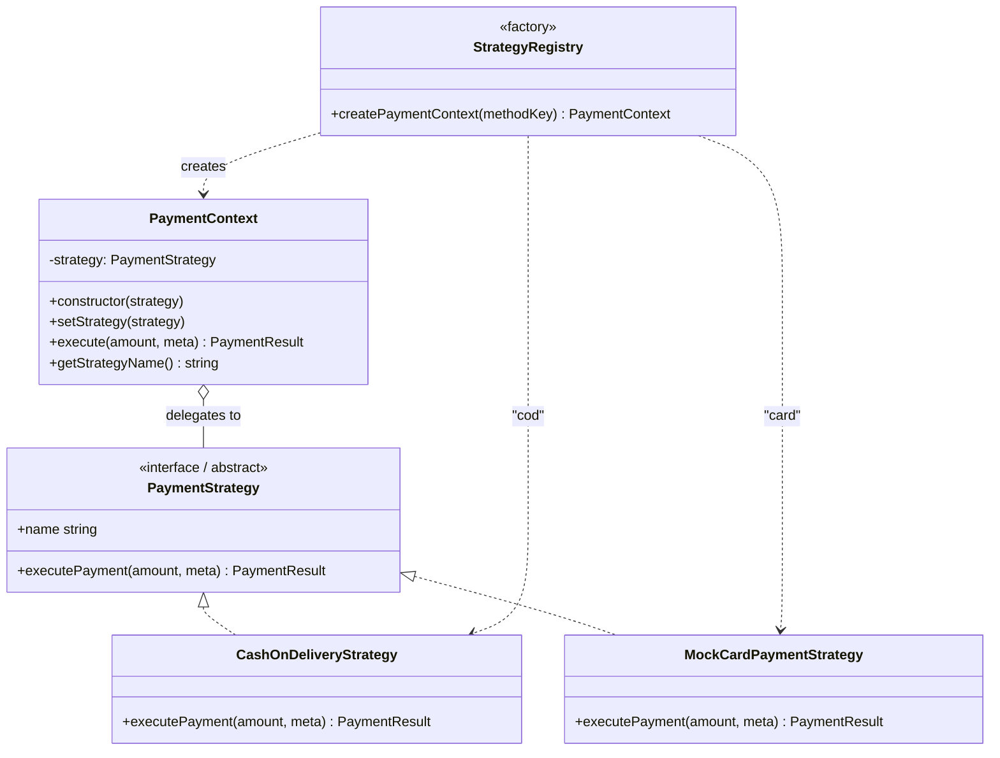
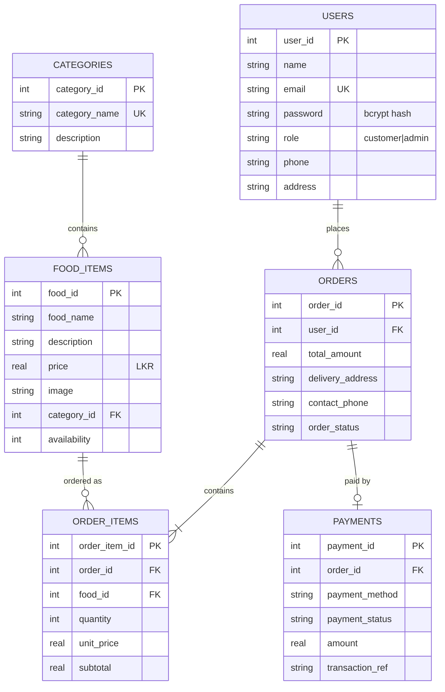

# Continuous Assessment 05
## System Development Using Software Architecture and Design Patterns

---

# Online Food Ordering System

| | |
|---|---|
| **System Title** | Online Food Ordering System |
| **Student Name(s)** | *[Insert your name]* |
| **Registration Number(s)** | *[Insert your reg. no.]* |
| **Module** | CA05 — System Development Using Software Architecture and Design Patterns |
| **Selected Architecture** | Client–Server Architecture |
| **Selected Design Pattern** | Strategy Design Pattern |
| **Submission Date** | *[Insert date]* |

---

## 1. Introduction

The rapid growth of e-commerce and food delivery services has changed the way people order meals. Customers now expect to browse menus, customize orders and pay online from their phones or computers, while restaurant owners need a simple way to manage menus, categories and incoming orders.

The **Online Food Ordering System** (branded *FoodDash*) is a web-based platform that connects customers with a restaurant menu. Customers can register, browse food items, search and filter by category, build a shopping cart, choose a delivery address and payment method, place an order and track it until delivery. An administrator dashboard allows staff to manage food items, categories, customers and order statuses.

The system is intentionally designed as a **three-layer client–server application**: a React.js front end, an Express.js REST API back end, and a SQLite database. Payment processing is implemented using the **Strategy design pattern**, making payment methods interchangeable without changing the order-placement code.

## 2. Problem Statement

Traditional food ordering by telephone or walk-in has several limitations:

- Customers cannot browse the full menu, prices or descriptions before ordering.
- Orders are recorded manually, leading to errors in items, quantities and totals.
- There is no order tracking — customers cannot see whether their food is pending, preparing or out for delivery.
- Restaurants must manually calculate totals, delivery fees and payment reconciliation.
- Adding a new payment option (e.g., wallets, online banking) to a conventional system usually requires rewriting payment logic.

A digital ordering system solves these problems by centralizing the menu, automating order and payment processing, and giving both customers and administrators real-time visibility. This project develops such a system while demonstrating two core software engineering concepts: **Client–Server Architecture** and the **Strategy Design Pattern**.

## 3. Objectives and Scope

### 3.1 Objectives

1. Design and develop a fully functional online food ordering web application.
2. Implement the **Client–Server Architecture** with a clear separation between presentation, business logic and data storage.
3. Implement the **Strategy Design Pattern** in the payment module so payment methods can be selected and extended at runtime.
4. Provide customer features: registration, login, menu browsing, search, filtering, cart management, checkout, payment, order history and tracking.
5. Provide an administrator dashboard: statistics, food/category CRUD, order management, status updates and customer information.
6. Ensure security through JWT authentication, bcrypt password hashing and role-based authorization.
7. Test all major functionalities and document the results.

### 3.2 Intended Users

- **Customers** — browse, order and track food.
- **Administrators** — manage the menu and fulfil orders.

### 3.3 Scope

**In scope:** web-based ordering for a single restaurant, two payment methods (Cash on Delivery and simulated Card payment), SQLite persistence, REST APIs, admin reporting.

**Out of scope:** real payment gateway integration, delivery rider app, multi-restaurant support, mobile native apps, online reviews/ratings.

## 4. System Requirements

### 4.1 Functional Requirements

| ID | Requirement |
|----|-------------|
| FR-1 | Customers can register and log in with JWT-based sessions. |
| FR-2 | Customers can browse all available food items with name, description, price (LKR), image and category. |
| FR-3 | Customers can search food by name and filter by category. |
| FR-4 | Customers can add items to a cart, change quantities and remove items. |
| FR-5 | The system calculates subtotal, delivery fee (LKR 250) and total automatically. |
| FR-6 | Customers can enter delivery address, contact phone and select a payment method. |
| FR-7 | Customers can place orders and receive a confirmation with a transaction reference. |
| FR-8 | Customers can view order history and track order status. |
| FR-9 | Customers can view and edit their profile. |
| FR-10 | Administrators can view dashboard statistics (orders, customers, items, revenue, status breakdown). |
| FR-11 | Administrators can add, edit and delete food items and categories. |
| FR-12 | Administrators can view all orders, view order details and update order status (`Pending → Confirmed → Preparing → Out for Delivery → Delivered / Cancelled`). |
| FR-13 | Administrators can view customer information. |

### 4.2 Non-Functional Requirements

| ID | Requirement |
|----|-------------|
| NFR-1 | Passwords must be hashed with bcrypt; never stored in plain text. |
| NFR-2 | All protected endpoints require a valid JWT; admin endpoints require the `admin` role. |
| NFR-3 | Server must validate all inputs and never trust client-supplied prices. |
| NFR-4 | Orders, order items and payments must be written in a single database transaction. |
| NFR-5 | The UI must be responsive and work on desktop and mobile. |
| NFR-6 | Card payment must be simulated only — no real card numbers, CVV or banking credentials are collected or stored. |

## 5. Selected Software Architecture — Client–Server Architecture

### 5.1 Description

Client–Server Architecture splits a system into **clients** that request services and **servers** that provide them. The client handles presentation and user interaction; the server handles all business logic, authentication, payment processing and database access. Communication happens over a standard request/response protocol — here, **HTTP REST APIs returning JSON**.

### 5.2 Justification

- It is a natural fit for a web application: browsers are clients, a centralized API is the server.
- It gives a **clean separation of concerns** — UI code never touches the database, which is an explicit assessment requirement.
- The REST API layer makes the backend testable (we tested every endpoint with `curl`) and keeps the client replaceable.
- It directly demonstrates distributed system concepts: request routing, middleware, stateless authentication (JWT) and a dedicated data tier.

### 5.3 Architecture Diagram



### 5.4 Responsibilities

| Tier | Technology | Responsibility |
|------|-----------|----------------|
| Client | React.js + Vite + Tailwind | Render UI, manage cart/auth state, send HTTP requests, display responses |
| Server | Node.js + Express.js | Receive requests, verify JWT, enforce roles, run business logic, execute payment strategies, query the database |
| Database | SQLite | Persistent storage with foreign keys, constraints and transactions |

**Key evidence in code:** `client/src/services/api.js` is the single HTTP gateway; `server/src/index.js` mounts all routes; `server/src/middleware/auth.js` implements JWT authentication and role authorization; `server/src/database/db.js` owns the schema.

## 6. Selected Design Pattern — Strategy Design Pattern

### 6.1 Description

The **Strategy pattern** defines a family of interchangeable algorithms, encapsulates each algorithm in its own class, and lets the client select which algorithm to execute **at runtime** — eliminating large conditional statements and making new algorithms easy to add (Open/Closed Principle).

### 6.2 Justification

Payment processing is the ideal place for Strategy because:

- The system supports multiple payment methods (Cash on Delivery, Card) with different behaviour.
- The checkout flow must select a method dynamically based on user input.
- Adding a future method (wallet, bank transfer) should require only a new class — no changes to order-placement code.

### 6.3 Design Pattern Diagram (UML)



### 6.4 Implementation

| File | Role |
|------|------|
| `server/src/strategies/PaymentStrategy.js` | Abstract contract declaring `executePayment(amount, meta)` |
| `server/src/strategies/CashOnDeliveryStrategy.js` | Confirms the order; payment collected on delivery; returns a `COD-…` reference |
| `server/src/strategies/MockCardPaymentStrategy.js` | Simulates a card gateway (validation + approval/decline); returns a `CARD-…` reference |
| `server/src/strategies/PaymentContext.js` | Holds the active strategy and delegates `execute()`; strategy swappable at runtime via `setStrategy()` |
| `server/src/strategies/index.js` | Registry mapping `'cod'`/`'card'` → strategy class → ready `PaymentContext` |

**Runtime workflow:** the checkout page sends `payment_method` with the order → `orderController.placeOrder` asks the registry for a `PaymentContext` → the context delegates to the selected strategy → the result (success, transaction ID, message) is stored in the `payments` table inside the same transaction as the order.

**Demonstration points:** there is no payment `if/else` in the controller; each method is an independent class; strategies are chosen at runtime; `POST /api/payments/process` lets a strategy be exercised standalone.

## 7. System Design

### 7.1 Use Case Summary

- **Customer:** register → login → browse/search menu → add to cart → checkout (address + payment) → order confirmation → track order.
- **Admin:** login → dashboard statistics → manage food/categories → view orders → update status.

### 7.2 Database Design (ER Diagram)



**Integrity:** foreign keys enabled, `CHECK` constraints on role/status/price/quantity, `UNIQUE` emails and category names, `ON DELETE CASCADE` on order items. Orders + items + payments are inserted inside one `BEGIN IMMEDIATE … COMMIT` transaction, and prices are always re-read from the database — never trusted from the client.

### 7.3 Interface Design

The UI uses a restaurant-style theme (orange primary, charcoal secondary, warm yellow accents), a sticky navigation bar with cart badge, card-based food grid, quantity steppers, a checkout form with payment-method radio cards, a 5-step order tracking stepper, toast notifications, loading skeletons and empty states. See Section 9 screenshots.

## 8. Implementation

### 8.1 Technologies

| Layer | Technology |
|-------|-----------|
| Frontend | React.js 18, Vite 6, Tailwind CSS 3, React Router 6, Axios, Lucide React |
| Backend | Node.js 24, Express.js 4, `node:sqlite` (built-in), jsonwebtoken, bcryptjs, cors |
| Database | SQLite (`server/src/data/food_ordering.db`) |
| Language | JavaScript (ES Modules) |

### 8.2 How to Run

```bash
npm install --prefix server && npm install --prefix client
npm run server    # API on :5000
npm run client    # UI on :5173
```

Database schema and seed data (8 categories, 19 food items, admin account) are created automatically on first start.

### 8.3 Key Implementation Notes

- **Auth:** `POST /api/auth/register|login` → bcrypt hash + JWT (7-day expiry). `authenticate` middleware verifies the Bearer token; `authorize('admin')` guards admin routes.
- **Orders:** `POST /api/orders` validates the cart against the DB, recomputes prices, executes the selected payment strategy via `PaymentContext`, then writes order + items + payment atomically.
- **REST API:** full endpoint list is in `README.md` (auth, foods, categories, orders, payments, profile, admin).
- **Frontend state:** `AuthContext` (JWT + user), `CartContext` (localStorage-persisted cart with totals), `ToastContext` (notifications).

## 9. System Demonstration — Screenshots

> **Action required:** capture the screenshots below while running the app (`npm run dev`) and replace each placeholder with the image file (e.g., `docs/screenshots/01-home.png`). Keep filenames consistent.

### 9.1 Customer Module

| # | Screenshot | What it shows | File |
|---|-----------|---------------|------|
| S1 | **Home page** | Hero section, category cards, popular items | `screenshots/01-home.png` |
| S2 | **Menu page** | Food grid with search bar and category filter pills | `screenshots/02-menu.png` |
| S3 | **Food details** | Single item: image, description, price, quantity selector, Add to Cart | `screenshots/03-food-details.png` |
| S4 | **Shopping cart** | Cart items with quantity controls, order summary (subtotal + delivery fee + total in LKR) | `screenshots/04-cart.png` |
| S5 | **Checkout — COD** | Delivery form + "Cash on Delivery" payment option selected | `screenshots/05-checkout-cod.png` |
| S6 | **Checkout — Card** | "Card Payment" selected showing card-holder field (simulated) | `screenshots/06-checkout-card.png` |
| S7 | **Order confirmation** | Success screen with order ID, payment method and transaction reference | `screenshots/07-order-confirmation.png` |
| S8 | **Order tracking** | 5-step status stepper (Pending → Delivered) with items and payment info | `screenshots/08-order-tracking.png` |
| S9 | **Order history / Customer dashboard** | List of past orders with status badges and statistics cards | `screenshots/09-customer-dashboard.png` |
| S10 | **Profile page** | Editable name, phone, address and password | `screenshots/10-profile.png` |

### 9.2 Administrator Module

| # | Screenshot | What it shows | File |
|---|-----------|---------------|------|
| S11 | **Admin login** | Login page used with `admin@foodorder.com` | `screenshots/11-login.png` |
| S12 | **Admin dashboard** | Total orders/customers/items/revenue cards + order statistics chart | `screenshots/12-admin-dashboard.png` |
| S13 | **Food management** | Food table with Add/Edit/Delete actions | `screenshots/13-admin-foods.png` |
| S14 | **Add/Edit food modal** | Form for food name, price, category, image URL, availability | `screenshots/14-food-modal.png` |
| S15 | **Category management** | Category cards with item counts and CRUD | `screenshots/15-admin-categories.png` |
| S16 | **Order management** | All orders table with status filter and inline status dropdown | `screenshots/16-admin-orders.png` |
| S17 | **Order details (admin)** | Order items, customer info, payment transaction reference, status update | `screenshots/17-admin-order-details.png` |
| S18 | **Customers list** | Customer table with orders count and total spent | `screenshots/18-admin-customers.png` |

### 9.3 Strategy Pattern Evidence (optional but impressive)

| # | Screenshot | What it shows | File |
|---|-----------|---------------|------|
| S19 | **Strategy code** | `server/src/strategies/` files open in the IDE showing the three classes | `screenshots/19-strategy-code.png` |
| S20 | **Payment result** | `POST /api/payments/process` response showing `strategy: "MockCardPaymentStrategy"` | `screenshots/20-payment-process.png` |

### 9.4 Suggested capture steps

1. `npm run dev` → open `http://localhost:5173`.
2. Register a customer, browse the menu, add items, checkout with **Cash on Delivery**, screenshot the confirmation.
3. Place a second order with **Card Payment**.
4. Log in as `admin@foodorder.com` / `admin123` → screenshot dashboard, foods, categories, orders; open an order and change its status to *Preparing* → screenshot tracking page again.

## 10. Testing

Testing combined **manual UI testing** with **automated REST API tests** executed via `curl` against the running server. All results below were actually executed (see `docs/testing.md` for the full log).

### 10.1 Test Cases

| TC | Test Case | Steps | Expected | Actual | Result |
|----|-----------|-------|----------|--------|--------|
| 1 | Customer registration | POST `/api/auth/register` with valid data | 201, JWT + user object | 201 with token | ✅ Pass |
| 2 | Customer login | POST `/api/auth/login` valid credentials | 200 + JWT | 200 + token | ✅ Pass |
| 3 | Invalid login | Login with wrong password | 401 error | 401 "Invalid email or password" | ✅ Pass |
| 4 | Duplicate registration | Register same email twice | 409 conflict | 409 "email already exists" | ✅ Pass |
| 5 | Food menu display | GET `/api/foods` | All items with category names | 19 items returned | ✅ Pass |
| 6 | Food search | GET `/api/foods?search=chicken` | Only matching items | Filtered correctly | ✅ Pass |
| 7 | Category filter | GET `/api/foods?category=2` | Only pizza items | Correct subset | ✅ Pass |
| 8 | Add to cart & totals | Add 2 items, change qty, remove | Subtotal + LKR 250 fee + total | Totals computed correctly | ✅ Pass |
| 9 | COD payment | Place order `payment_method:"cod"` | `CashOnDeliveryStrategy`, `COD-…` ref, payment row | Confirmed | ✅ Pass |
| 10 | Card payment | Place order `payment_method:"card"` + holder name | `MockCardPaymentStrategy`, `CARD-…` ref | Approved (simulated) | ✅ Pass |
| 11 | Card validation | Card payment without holder name | 402 error, no order | Error returned | ✅ Pass |
| 12 | Order placement | POST `/api/orders` valid cart | 201; order+items+payment in one transaction | Total verified (e.g., LKR 2,250) | ✅ Pass |
| 13 | Order history | GET `/api/orders/my-orders` | Only own orders | Correct | ✅ Pass |
| 14 | Order tracking | GET `/api/orders/my-orders/:id` | Items, totals, payment ref, status | Correct | ✅ Pass |
| 15 | Admin food CRUD | POST/PUT/DELETE `/api/foods` as admin | Create/edit/delete succeed | All verified | ✅ Pass |
| 16 | Admin category CRUD | POST/PUT/DELETE `/api/categories` | CRUD works; delete blocked if items exist | Verified | ✅ Pass |
| 17 | Admin order mgmt | GET `/api/orders`, PUT status | List/filter/update status | Status → "Preparing" saved | ✅ Pass |
| 18 | Unauthorized access | POST `/api/foods` without token; GET `/api/orders` as customer | 401 / 403 | Both rejected | ✅ Pass |
| 19 | Frontend build | `npm run build` (Vite) | Production build succeeds | Built in ~13 s | ✅ Pass |

**Summary:** 19/19 test cases passed. No outstanding defects.

## 11. Conclusion and Future Improvements

### 11.1 Conclusion

The Online Food Ordering System was designed, implemented and tested successfully as a Client–Server application. The React client communicates with the Express server exclusively through REST APIs, and the server manages all business logic and SQLite persistence — a clean three-tier separation. The Strategy pattern is genuinely implemented in the payment module: `PaymentStrategy` defines the contract, `CashOnDeliveryStrategy` and `MockCardPaymentStrategy` are independent implementations, and `PaymentContext` selects and executes them at runtime with no conditional payment logic.

All functional requirements were verified through executed tests, including order total calculation, both payment strategies, transactional order storage and role-based access control.

### 11.2 Limitations

- Card payment is simulated — no real payment gateway is integrated.
- Single-restaurant scope; no rider/delivery tracking.
- SQLite is file-based — suitable for demonstration, not high concurrency.
- Cart is stored in browser localStorage.

### 11.3 Future Improvements

- Integrate a real payment gateway (Stripe, PayHere, Visa/Mastercard).
- Add online order status push notifications (WebSockets / SSE).
- Multi-restaurant / multi-branch support with separate menus.
- Move to a client-server DB (PostgreSQL/MySQL) for scale.
- Add customer reviews, favourites, promo codes and loyalty points.
- Deploy with Docker and CI/CD.

## 12. References

1. Gamma, E., Helm, R., Johnson, R., & Vlissides, J. (1994). *Design Patterns: Elements of Reusable Object-Oriented Software*. Addison-Wesley. *(Strategy pattern)*
2. Shaw, M., & Garlan, D. (1996). *Software Architecture: Perspectives on an Emerging Discipline*. Prentice Hall. *(Client–Server architecture)*
3. Fielding, R. T. (2000). *Architectural Styles and the Design of Network-based Software Architectures*. PhD dissertation, UC Irvine. *(REST)*
4. Express.js documentation — https://expressjs.com
5. React documentation — https://react.dev
6. MDN Web Docs — JSON Web Token (JWT) — https://developer.mozilla.org/en-US/docs/Web/API/Web_Authentication_API
7. SQLite documentation — https://sqlite.org/docs.html
8. bcrypt — https://github.com/kelektiv/node.bcrypt.js

---

*End of Report*
