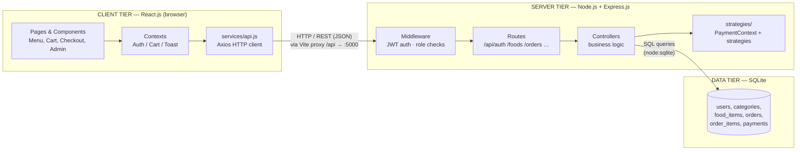

# Client–Server Architecture

## Diagram

## Responsibilities

| Component | Responsibility |
|-----------|----------------|
| **React Client** | Renders UI, manages cart/auth state, collects user input, sends HTTP requests, displays server responses. **Never touches the database.** |
| **Express Server** | Receives REST requests, verifies JWT, enforces roles, runs business logic (order totals, stock checks), executes payment strategies, queries SQLite, returns JSON responses. |
| **SQLite Database** | Persistent storage for users, categories, food items, orders, order items and payments with foreign-key integrity and transactions. |

## Where it is implemented in code

- Client HTTP layer: `client/src/services/api.js` (single Axios instance; JWT attached automatically)
- Server entry & route mounting: `server/src/index.js`
- Endpoint definitions: `server/src/routes/*.js`
- Business logic: `server/src/controllers/*.js`
- Auth middleware: `server/src/middleware/auth.js`
- Database: `server/src/database/db.js`

## Request flow example (place order)

1. Customer clicks **Place Order** → `orderApi.create()` sends `POST /api/orders`.
2. Vite proxies `/api` → `http://localhost:5000`.
3. `authenticate` middleware verifies the JWT.
4. `orderController.createOrder` recalculates totals from DB prices, selects a payment strategy, executes it via `PaymentContext`, then writes `orders` + `order_items` + `payments` in **one SQL transaction**.
5. JSON response returns to the client → order confirmation screen.
