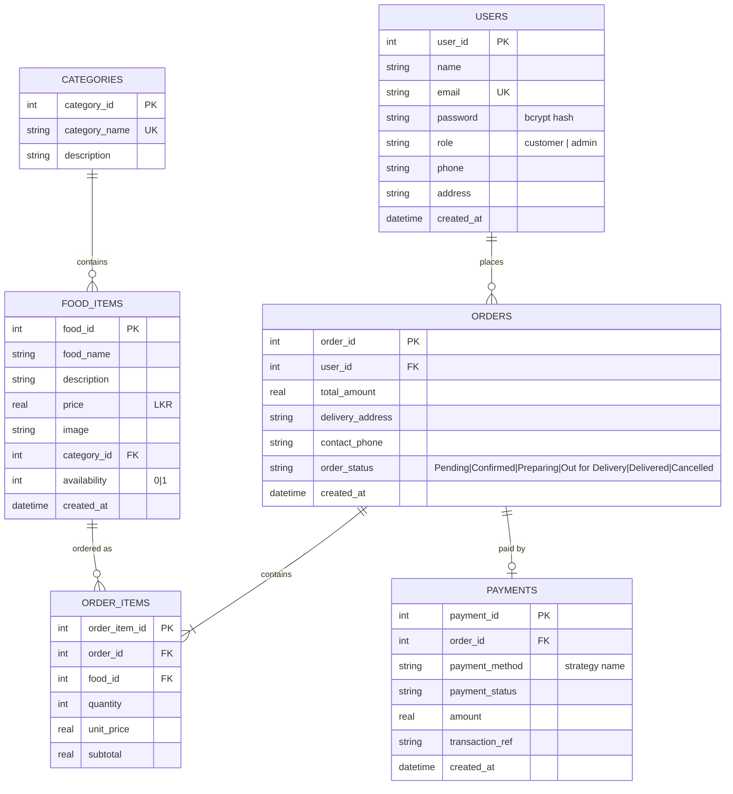

# Database ER Diagram — SQLite

## Integrity & transactions

- `PRAGMA foreign_keys = ON` enforces referential integrity.
- `ON DELETE CASCADE` on `order_items.order_id`.
- `CHECK` constraints on `role`, `availability`, `quantity`, `price` and `order_status`.
- Placing an order runs inside a single `BEGIN IMMEDIATE … COMMIT` transaction (`orderController.placeOrder`), rolling back on any failure — orders, order items and the payment record are always consistent.
- Prices are **never trusted from the client**: the server re-reads each `food_id` price from `food_items` and recomputes subtotals + delivery fee.
