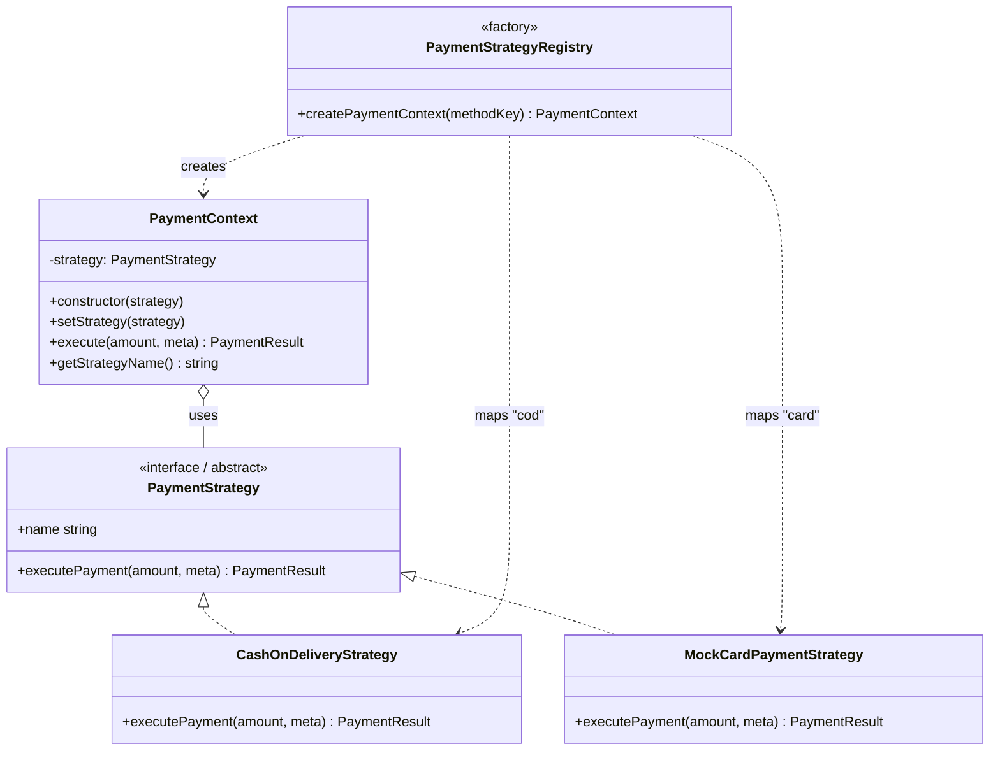
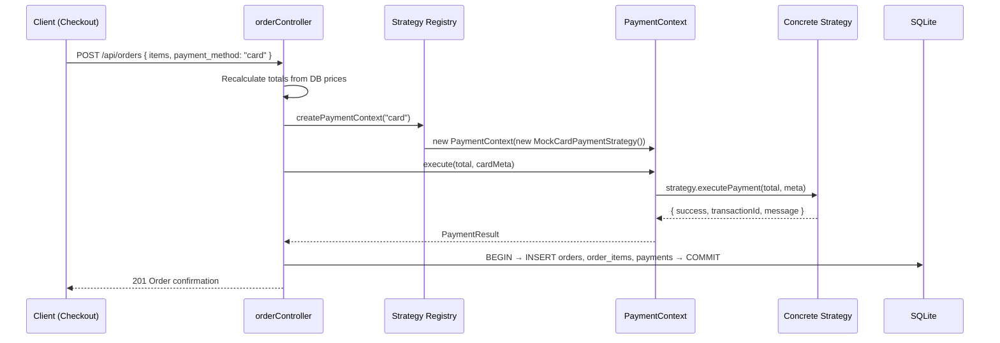

# Strategy Design Pattern — Payment Module

## Concept

The **Strategy pattern** defines a family of interchangeable algorithms, encapsulates each one in its own class, and lets the client choose which algorithm to use at runtime — without `if/else` chains in the calling code.

Applied here to **payment processing**: `CashOnDeliveryStrategy` and `MockCardPaymentStrategy` are swappable payment algorithms behind a common `PaymentStrategy` contract, executed through `PaymentContext`.

## UML Class Diagram

## Source files

| File | Role |
|------|------|
| `server/src/strategies/PaymentStrategy.js` | Common interface (abstract base class) declaring `executePayment(amount, meta)` |
| `server/src/strategies/CashOnDeliveryStrategy.js` | Concrete strategy — confirms order, payment collected on delivery |
| `server/src/strategies/MockCardPaymentStrategy.js` | Concrete strategy — simulates card gateway approval/decline |
| `server/src/strategies/PaymentContext.js` | Context holding the active strategy; delegates `execute()` to it; strategy swappable at runtime via `setStrategy()` |
| `server/src/strategies/index.js` | Registry/factory: maps `'cod'`/`'card'` → strategy class → `PaymentContext` |

## Runtime workflow

## Key points for demonstration

- **No payment `if/else`:** the controller asks the registry for a context by method key; behaviour lives entirely inside strategy classes.
- **Runtime selection:** `PaymentContext.setStrategy()` allows swapping strategies without changing client code.
- **Common contract:** every strategy implements `executePayment(amount, meta)` and returns `{ success, transactionId, message, method }`.
- **Open/Closed:** adding e.g. `WalletStrategy` requires only a new class + one registry entry.
- **Simulated card payment:** `MockCardPaymentStrategy` performs no real charging and stores no card numbers/CVV — it only validates a demo holder name and returns a mock transaction reference. A demo card number ending in `0000` simulates a decline.
